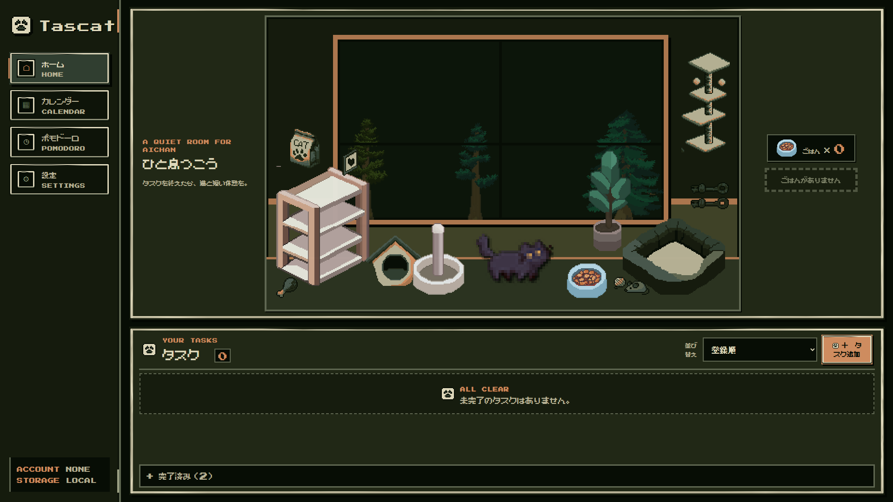
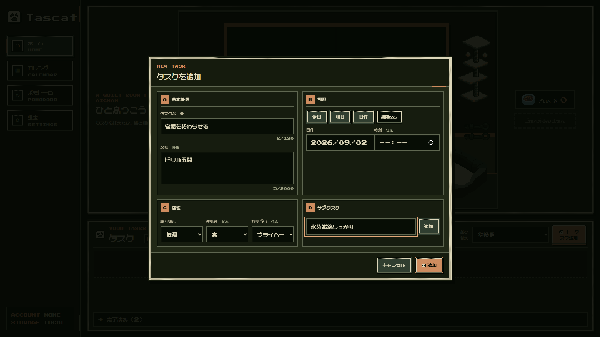
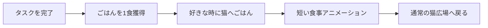
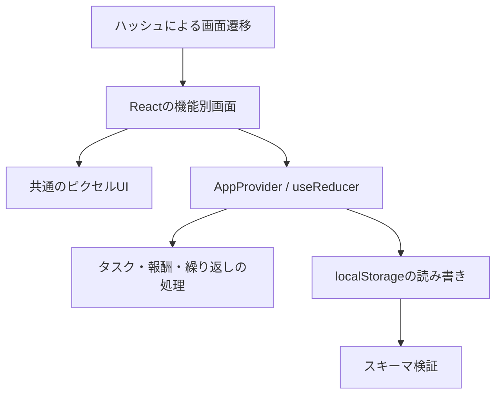

<h1 align="center">
  
</h1>

<p align="center"><strong>タスクを片付けたあとに、猫とひと息つけるピクセルToDoアプリ。</strong></p>

<p align="center">アカウント不要 · ローカルファースト · 個人利用向け</p>

<p align="center"><a href="https://tascat.vercel.app/"><strong>Tascatを開く</strong></a></p>

<p align="center">
  <a href="#development">開発・公開状況</a> ·
  <a href="#screenshots">プレビュー</a> ·
  <a href="#features">主な機能</a> ·
  <a href="#technology">技術スタック</a> ·
  <a href="#quickstart">セットアップ</a> ·
  <a href="#documentation">ドキュメント</a>
</p>

---

<a id="development"></a>

## 開発・公開状況

| 項目 | 内容 |
| --- | --- |
| 開発開始 | 2025年9月 |
| MVP完成 | 2025年11月 |
| 現在の状況 | 開発停止 |
| GitHub初回公開 | 2026年9月 |
| 公開アプリ | [Tascatを開く](https://tascat.vercel.app/) |

<a id="screenshots"></a>

## 🖼️ プレビュー

| 猫広場を中心にしたホーム画面 | タスク追加モーダル |
| --- | --- |
|  |  |

## 🐈 Tascatとは

Tascatは、タスク管理と短い癒しを組み合わせた個人向けWebアプリケーションです。親タスクを1件完了すると猫のごはんを1食獲得でき、好きなタイミングでAichanに与えられます。

競争や育成のためのゲームではありません。タスクを終えた直後に小さな休息を挟み、次の行動へ気持ちを切り替えるための静かな体験を目指しています。

## 💡 なぜ作ったか

一般的なToDoアプリでは、完了チェックのあとに達成感より疲れが残ることがあります。そこで「やることを整理する」だけでなく、やり切った直後に猫との短い時間を置くことで、作業と生活の間に自然な区切りを作りました。

## 🔁 コア体験



同じタスクから獲得できるごはんは最大1食です。完了解除後に再び完了しても報酬は増えず、繰り返しタスクの次回分も重複生成されません。

<a id="features"></a>

## ✨ 主な機能

- ✅ タスクの追加・編集・削除・完了解除とサブタスク管理
- ✅ 全サブタスク完了後のみ親タスクを完了できる制約
- 🍚 1タスク1食を保証するごはん報酬
- 🐈 Aichanの待機・食事のピクセルアニメーション
- 🔁 毎日・毎週・毎月の繰り返しタスクと重複防止
- 📅 月表示カレンダーと日付からのタスク追加
- ⏱️ 25分集中・5分休憩の固定ポモドーロ
- 💾 アカウント不要のlocalStorage保存
- 🎨 深い森林と暖かな木を基調とした一貫したピクセルUI
- ♿ WCAG 2.2のレベルAAを意識したキーボード操作と画面幅に応じた再配置

検索、通知、同期、統計、ランキング、育成要素は実装していません。

<a id="technology"></a>

## 🛠️ 技術スタック

| 技術 | 役割 |
| --- | --- |
| React 19.2 | 4画面、モーダル、猫アニメーションの宣言的UI |
| TypeScript 6.0 | ドメインモデルと状態遷移の型安全性 |
| Vite 8.2 | 開発サーバーと静的プロダクションビルド |
| Tailwind CSS 4.3 + CSSのデザイントークン | リセット基盤と独自ピクセルUIの設計 |
| React `useReducer` + Context | タスク・報酬・繰り返しの原子的な更新 |
| localStorage | 現在のブラウザ内だけの永続化 |
| Vitest + Testing Library | 単体・結合テスト |
| Playwright + axe-core | E2E、ブラウザ互換、アクセシビリティ検査 |
| Vercel | `dist` の静的配信 |

バックエンド、外部API、データベース、環境変数は使用しません。

## 🏗️ アーキテクチャ概要



ドメイン処理はUIから分離した純粋関数を中心に構成しています。親タスク完了時の「完了更新・初回報酬・次回生成」は単一のリデューサーのアクションで処理し、中間状態や再描画による二重付与を防ぎます。

永続化には、利用者1人・端末内限定・少量データ・同期なしという要件に最も単純に合うlocalStorageを採用しました。保存データにはスキーマの版を記録し、読み込み時に破損データを検出します。

## 🎨 設計・実装上の工夫

- `rewardClaimed` を完了解除と独立させ、1タスク1食を保証
- `generatedFromId` と生成済み状態により繰り返しタスクの二重作成を防止
- 終了予定時刻を基準にポモドーロ残時間を再計算し、ページ移動や再読込によるずれを抑制
- Aichanは待機・食事の画像を収めた小さなスプライトシートを整数倍率で描画
- HTMLが意味と操作を担い、加工済みのピクセル素材は外観に限定
- 第三者の元配布物を含めず、実行に必要な加工済み素材だけを公開

## ♿ アクセシビリティと品質保証

- セマンティックなナビゲーション、見出し、フォーム、ボタン
- 明確な `:focus-visible`、本文へのスキップリンク、キーボード操作
- ネイティブ `dialog` によるフォーカス拘束、Escキーでの閉じ操作、フォーカスの復帰
- ラベルと入力エラーの関連付け、画面読み上げへの通知
- 色と文字・形を併用した完了、優先度、無効状態
- `prefers-reduced-motion` でも食事状態の意味を維持
- 1280×720での表示と、幅320pxでの縦方向への再配置
- Chromiumの主要操作、FirefoxとWebKitの基本動作、axeで重大・致命的な問題が0件であることを自動検証
- 型検査、ESLint、単体・結合・E2Eテスト、本番ビルドで品質を確認

<a id="quickstart"></a>

## 🚀 セットアップ

### 必要環境

- Node.js 22.22.2以上
- npm 11以上

### インストールと起動

```bash
git clone <repository-url>
cd Tascat
npm ci
npx playwright install chromium firefox webkit
npm run dev
```

表示されたローカルURLをブラウザで開きます。Playwrightのブラウザ導入はE2Eとブランド画像の再生成に使用します。アプリの起動だけなら省略できます。`.env` は不要です。

### 検証とビルド

```bash
npm run typecheck       # TypeScript
npm run lint            # ESLint
npm test                # 単体・結合テスト
npm run test:coverage   # カバレッジの計測
npm run test:e2e        # 各ブラウザの動作とアクセシビリティの確認
npm run build           # distを生成
npm run preview         # 本番ビルドを確認
```

### アセット再生成

```bash
npm run brand:build
npm run assets:build
```

ブランドアセットは同梱スクリプトだけで再生成できます。`assets:build` はライセンス済みの元素材をローカルの `assets-source/` に配置した場合だけ使用する保守用コマンドです。通常の開発・ビルドには不要です。

## 📁 プロジェクト構成

```text
Tascat/
├─ docs/                  # 要件・設計・テスト・アセット資料
│  └─ screenshots/        # README用の指定スクリーンショット
├─ e2e/                   # Playwright E2E
├─ licenses/              # Conti Neue 2PのOFL 1.1
├─ public/
│  ├─ assets/             # フォントと加工済みのピクセル素材
│  └─ brand/              # Tascatロゴとサイトアイコン
├─ scripts/               # ブランド生成と任意のピクセル素材の再生成
├─ src/
│  ├─ app/                # 状態の提供とハッシュによる画面遷移
│  ├─ components/         # 猫のスプライトと共通の画面部品
│  ├─ domain/             # タスク・日付・報酬・ポモドーロの処理
│  ├─ features/           # ホーム・カレンダー・ポモドーロ・設定・タスク・猫
│  ├─ storage/            # localStorageの検証・読み書き
│  └─ test/               # テスト初期化
├─ playwright.config.ts
├─ vercel.json
└─ vite.config.ts
```

<a id="documentation"></a>

## 📚 ドキュメント

- [要件定義](docs/requirements.md)
- [アーキテクチャ](docs/architecture.md)
- [データモデル](docs/data-model.md)
- [デザインシステム](docs/design-system.md)
- [テスト戦略](docs/testing.md)
- [アセット運用](docs/assets.md)

## 🔒 データとプライバシー

- アカウント・ログインなし
- タスク、ごはん、報酬、タイマーを現在のブラウザだけに保存
- 利用データの外部送信・端末間同期なし
- 広告、課金、アクセス解析なし
- ブラウザデータを削除するとTascatのデータも消失

## ☁️ デプロイ

`vercel.json` にViteのビルドコマンド、`dist` 出力、SPAのフォールバック、セキュリティヘッダーを定義済みです。Vercelへリポジトリを取り込み、環境変数なしでデプロイできます。

## 📦 第三者素材とフォント

Conti Neue 2PはSIL Open Font License 1.1で配布され、ライセンス本文を [`licenses/ContiNeue2P-OFL.txt`](licenses/ContiNeue2P-OFL.txt) に保持しています。一部のピクセル素材は利用許諾を確認した第三者素材を加工したものです。公開リポジトリには実行に必要な素材だけを含め、元のZIPファイル・スプライトシート・未使用素材は再配布条件に従い含めません。詳細は[アセット運用](docs/assets.md)を参照してください。

プロジェクト全体に対するOSSライセンスは設定していません。

## ⚠️ 制約

- 端末間・ブラウザ間の同期はありません
- バックアップ、インポート、エクスポートはありません
- 複数タブで同時編集した場合は最後に保存された状態が優先されます
- 通知、音、履歴、統計、検索、フィルターはありません

## 👤 作者

**@zahin-dev**  
大学生 · 2028年卒業予定
